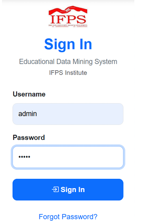
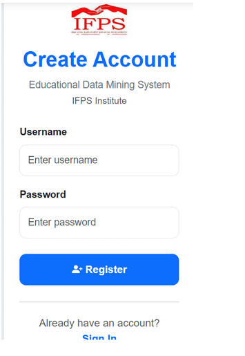
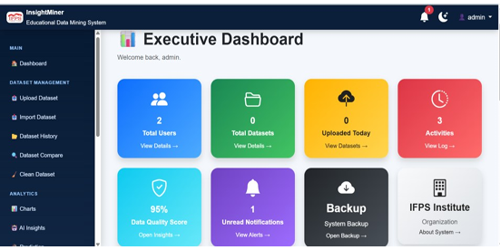
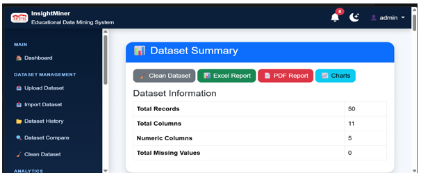
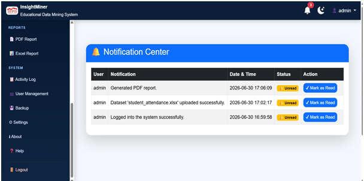
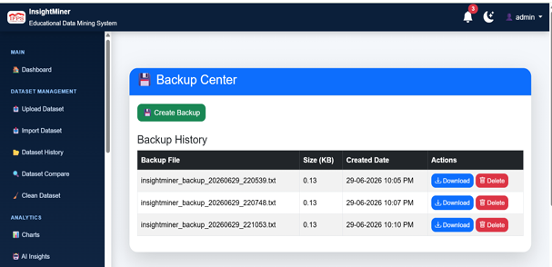

# InsightMiner – Data Mining and Analytics Application

**InsightMiner** is a web-based data mining application developed as a Master of Information Technology final project for IF Professional Studies Institute.

It helps users upload datasets, perform data analysis, visualize patterns, generate reports, and obtain meaningful insights from data.

## Features

- User authentication and role-based access control
- CSV and Excel dataset uploads
- Dataset summary and statistical analysis
- Data cleaning and preprocessing
- Interactive data visualizations
- Predictive analytics and machine learning
- PDF and Excel report generation
- Dataset history and comparison
- User activity logging and notifications

## Technologies Used

| Category | Technologies |
|---|---|
| Backend | Python, Flask |
| Frontend | HTML, CSS, JavaScript, Bootstrap |
| Database | MySQL |
| Data Analysis | Pandas, NumPy |
| Machine Learning | Scikit-learn |
| Visualization | Matplotlib, Seaborn |
| Reports | ReportLab, OpenPyXL |
| Development Tools | Visual Studio Code, Git, GitHub |

## Project Structure

```text
InsightMiner/
├── app.py
├── config.py
├── db.py
├── dataset_processor.py
├── routes/
├── templates/
├── static/
├── requirements.txt
└── README.md
```

## Installation and Setup

### 1. Clone the repository

```bash
git clone https://github.com/Jawahira-casim/InsightMiner.git
cd InsightMiner
```

### 2. Create a virtual environment

```bash
python -m venv .venv
```

### 3. Activate the virtual environment

Windows:

```bash
.venv\Scripts\activate
```

### 4. Install dependencies

```bash
python -m pip install -r requirements.txt
```

### 5. Configure the database

- Install and start MySQL.
- Create the required `insightminer` database.
- Configure your database connection settings locally.
- Configure the required environment variables and secret key.

### 6. Run the application

```bash
python app.py
```

Open your browser:

```text
http://127.0.0.1:5000
```

## Project Purpose

The main objective of InsightMiner is to simplify data analysis by providing an integrated platform for data preprocessing, exploratory analysis, visualization, predictive modelling, and report generation.

## Author

**Jawahira Casim**

Master of Information Technology (MIT)

## License

This project is available for educational and portfolio demonstration purposes.

## Application Screenshots

### Home Page


### Login


### Registration


### Dashboard


### Dataset Upload


### Data Cleaning


### Generate Charts


### AI Insights


### Predictive Analysis


### Reports


### Activity Log


### Notifications


### Database Backup


### User Profile
