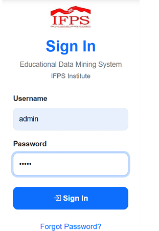
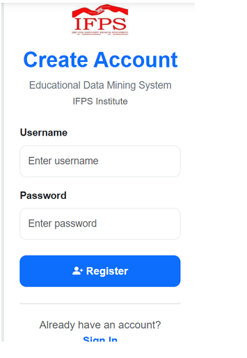
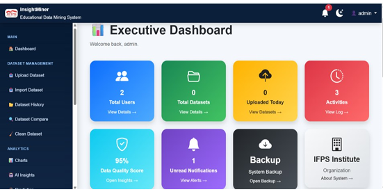
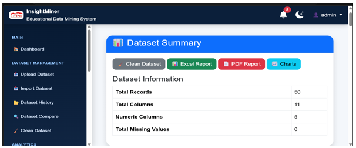
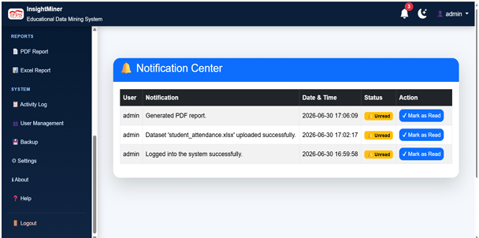
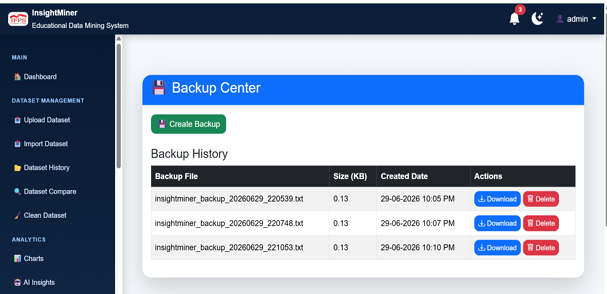

# InsightMiner – Data Mining and Analytics Application

**InsightMiner** is a web-based data mining and analytics application developed as a Master of Information Technology (MIT) final project for **IF Professional Studies Institute**.

The application provides an integrated platform for uploading datasets, cleaning and preprocessing data, performing statistical analysis, visualizing patterns, generating predictive models, and producing meaningful insights through reports.

## Key Features

- **User Authentication:** Secure login and registration with role-based access control.
- **Dataset Management:** Upload CSV and Excel datasets.
- **Data Analysis:** Generate dataset summaries and statistical analysis.
- **Data Cleaning:** Clean and preprocess uploaded datasets.
- **Data Visualization:** Generate charts and visual representations of data.
- **AI-Based Insights:** Extract meaningful insights from datasets.
- **Predictive Analytics:** Apply machine learning techniques for predictive analysis.
- **Report Generation:** Generate and download PDF and Excel reports.
- **Dataset History:** Maintain dataset records and support comparisons.
- **Activity Monitoring:** Track user activities through activity logs.
- **Notifications:** Manage system notifications.
- **Backup and Restore:** Create backups and restore application data.
- **User Management:** Manage application users and roles.

## Technologies Used

| Category | Technologies |
|---|---|
| Backend | Python, Flask |
| Frontend | HTML, CSS, JavaScript, Bootstrap |
| Database | MySQL |
| Data Analysis | Pandas, NumPy |
| Machine Learning | Scikit-learn |
| Data Visualization | Matplotlib, Seaborn |
| Report Generation | ReportLab, OpenPyXL |
| Development Tools | Visual Studio Code, Git, GitHub |

## Project Structure

```text
InsightMiner/
├── app.py
├── db.py
├── dataset_processor.py
├── decorators.py
├── notification_helper.py
├── activity.py
├── shared.py
├── routes/
├── templates/
├── static/
├── models/
├── screenshots/
├── requirements.txt
├── .env.example
└── README.md
```

## Installation and Setup

### 1. Clone the repository

```bash
git clone https://github.com/Jawahira-casim/InsightMiner.git
cd InsightMiner
```

### 2. Create a virtual environment

```bash
python -m venv .venv
```

### 3. Activate the virtual environment

For Windows PowerShell:

```powershell
.\.venv\Scripts\Activate.ps1
```

### 4. Install dependencies

```bash
python -m pip install -r requirements.txt
```

### 5. Configure environment variables

Create your local environment file from the example:

```powershell
Copy-Item .env.example .env
```

Open `.env` and configure the following variables with your own values:

```env
FLASK_SECRET_KEY=your_secure_secret_key

DB_HOST=your_database_host
DB_USER=your_database_username
DB_PASSWORD=your_database_password
DB_NAME=insightminer
```

**Important:** Never upload your actual `.env` file or database credentials to GitHub.

### 6. Configure the MySQL database

- Install and start MySQL.
- Create a database named `insightminer`.
- Configure the database connection details in `.env`.
- Ensure the required database tables are available.

### 7. Run the application

```bash
python app.py
```

Open the application in your browser:

```text
http://127.0.0.1:5000
```

## Application Screenshots

### Home Page


### Login



### Registration



### Dashboard



### Dataset Upload


### Data Cleaning


### Data Visualization


### AI-Based Insights


### Predictive Analysis


### Reports



### Activity Log


### Notifications



### Database Backup



### User Profile


## Project Purpose

The main objective of InsightMiner is to simplify the data mining process by integrating data preprocessing, exploratory data analysis, visualization, predictive modelling, and report generation into one web-based application.

The project demonstrates the practical application of Python-based web development, database management, data analytics, and machine learning.

## Author

**Jawahira Casim**

Master of Information Technology (MIT)

## Project Repository

[View InsightMiner on GitHub](https://github.com/Jawahira-casim/InsightMiner)

## Demo Video

*Demo video link will be added here.*

## License

This project is available for educational and portfolio demonstration purposes.
